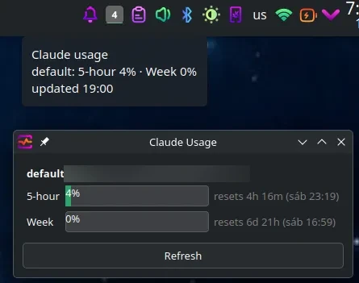

# Claude Usage Tray

<p align="center">
  
</p>

[](https://claude.com/claude-code)
[](LICENSE.md)


A small system-tray app for KDE Plasma (Wayland or X11) that shows your Claude plan usage —
the 5-hour window and weekly limits — for one or more Claude Code accounts.

It has no login of its own: it reuses the OAuth token Claude Code already stores in
`~/.claude/.credentials.json` and calls the same usage endpoint as the CLI's `/usage` command.

## Where it works

Tested on **Kubuntu 26.04, KDE Plasma 6, Wayland**. Everything else below is expected from how
the app is built but has **not been tested**.

The app uses Qt's `QSystemTrayIcon`. On Linux that publishes a **StatusNotifierItem** (the
freedesktop/KDE tray standard, over D-Bus) whenever the desktop provides one, and otherwise falls
back to the old X11 **XEmbed** tray. So what matters is whether your panel supports
StatusNotifierItem, not whether you run Wayland or X11.

| Desktop | Wayland | X11 | Notes |
|---|---|---|---|
| KDE Plasma 5/6 | ✅ tested (Plasma 6) | ✅ | Full support: icon, tooltip, left-click window, right-click menu. |
| GNOME (Ubuntu) | ✅ | ✅ | Ubuntu enables the *Ubuntu AppIndicators* extension by default. Tooltips are not shown. |
| GNOME (Fedora, Arch, Debian, …) | ⚠️ | ⚠️ | Stock GNOME has no tray. Install the [*AppIndicator and KStatusNotifierItem Support*](https://extensions.gnome.org/extension/615/appindicator-support/) extension. Without it the icon is just not visible, though the app keeps running. |
| Cinnamon, MATE, XFCE, LXQt, Budgie | ✅ | ✅ | Their panels support StatusNotifierItem. On XFCE, check the *Status Tray* (or *Notification Area*) panel plugin is added. |
| Sway, Hyprland, other wlroots | ✅ | — | Needs a bar with a tray, e.g. Waybar with the `tray` module. The details window opens as a normal window, so tiling compositors may tile it. |
| i3, Openbox, other X11 WMs | — | ✅ | Needs a tray (i3bar, polybar, stalonetray, …). Uses XEmbed if there's no StatusNotifierItem host. |

**Other platforms:**
- **Linux only.** On macOS Claude Code keeps its token in the Keychain, not in
  `~/.claude/.credentials.json`, so the app can't read it. Windows is untested, and the shell
  scripts won't run there.
- **Any distro** with Python 3.9+ and PyQt6 should work:
  - Debian/Ubuntu: `sudo apt install python3-pyqt6`
  - Fedora: `sudo dnf install python3-pyqt6`
  - Arch: `sudo pacman -S python-pyqt6`
  - Anywhere else: `pip install --user PyQt6`
- **Autostart** uses `~/.config/autostart`, the XDG standard that all of the desktops above
  follow.
- The **Log in…** button opens the first terminal it finds: konsole, ptyxis, gnome-terminal,
  kgx, xfce4-terminal, x-terminal-emulator or xterm. If you have none of these, run
  `claude auth login` yourself; the tray picks up the login either way.

## Install

Requirements: Python 3, PyQt6 (see above), and the `claude` CLI on your `PATH`.

```bash
./install.sh
```

This adds an app-menu entry and a login autostart entry, then starts the tray immediately
(restarting it if it was already running). Run it again any time after updating the code.

## Using it

| Where | What you get |
|---|---|
| **Icon** | Highest 5-hour usage % across accounts. Fill turns amber at 70%, red at 90%. A red **!** means an account is logged out and nothing has data. |
| **Hover** | 5-hour and weekly % per account, or "logged out". |
| **Left-click** | Details window: progress bars and reset times for each limit (including Opus/Sonnet weekly limits if your plan has them), plus a **Log in…** button for logged-out accounts. |
| **Right-click** | Per-account summary and reset times, **Log in …** for logged-out accounts, Show details, Refresh now, Open config, Quit. |

Usage refreshes every 5 minutes. Logging in or out, and adding a new profile directory, are
picked up within a couple of seconds.

### Logged out

If an account has no credentials, or its token is rejected, it shows as **logged out**
instead of stale numbers. Click **Log in…** (menu or details window) to open Konsole with
`claude auth login` for that account, or run it yourself. The tray updates as soon as the
login finishes.

Claude Code access tokens last about 8 hours and the CLI refreshes them when you use it. If a
token has expired, the tray runs `claude auth status` for that profile so the CLI can renew
it. The tray never rotates tokens itself, so it can't log your CLI out.

## Multiple accounts

Claude Code can keep each login in its own config directory (`CLAUDE_CONFIG_DIR`), so you don't
have to keep switching with `/login`:

```bash
./add-account.sh work       # creates ~/.claude-work and opens the browser login
./add-account.sh side
./add-account.sh personal
```

Then add aliases to `~/.bashrc`:

```bash
alias claude-work='CLAUDE_CONFIG_DIR=~/.claude-work claude'
```

The tray always shows `~/.claude` as **default** and picks up any `~/.claude-<name>` directory
automatically. New profiles start without your `settings.json` and plugins, so copy or
symlink those over if you want them.

## Configuration

`~/.config/claude-usage-tray/config.json` (created on first run, re-read on every refresh):

```json
{
  "refresh_minutes": 5,
  "accounts": []
}
```

To pick the accounts and their names yourself instead of auto-discovery:

```json
"accounts": [
  {"name": "personal", "dir": "~/.claude"},
  {"name": "work", "dir": "~/.claude-work"}
]
```

## Troubleshooting

- **Run in the foreground to see errors:** `pkill -f claude_usage_tray.py; python3 claude_usage_tray.py`
  (only one copy can run at a time).
- **Don't start it with `python3 claude_usage_tray.py &` from a shell.** A background job that
  touches the terminal gets stopped by job control, which freezes the tray: the right-click
  menu takes ~15 s and does nothing. `install.sh` starts it detached with `setsid`.
- The usage endpoint (`/api/oauth/usage`) is unofficial and undocumented. If it changes, the
  tray shows an HTTP error rather than wrong numbers.

## Files

- `claude_usage_tray.py` — the app
- `install.sh` — installs menu and autostart entries, then (re)starts the app
- `add-account.sh` — creates and logs in an extra Claude Code profile
